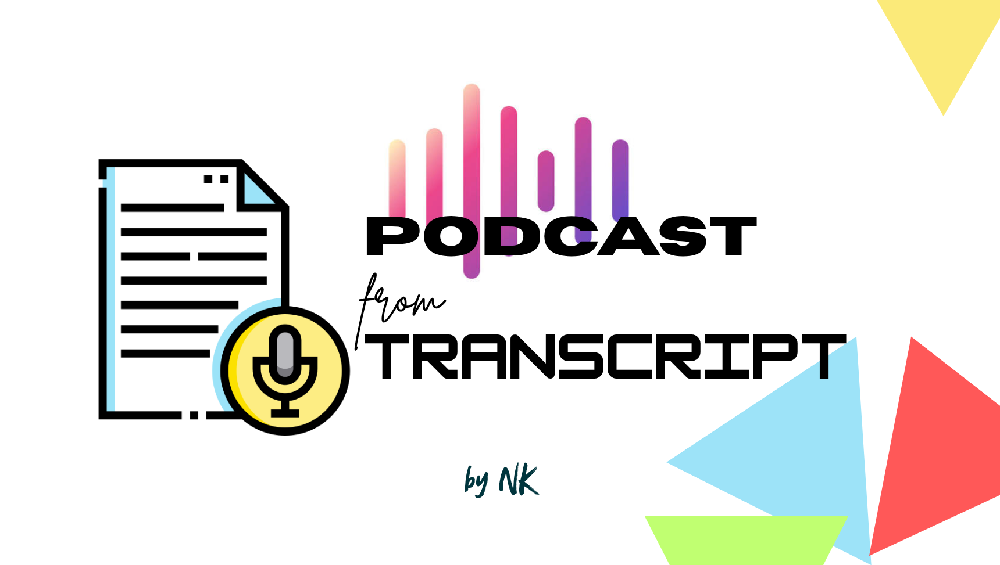

# Podcast From Transcript

Turn a thought into a podcast :)

## Quick Demo

This project turns a transcript into podcast-style audio using Gemini TTS.

<div align="center">
  <em><a href="https://youtu.be/Bqr9OCaVjZo">Watch a quick demo on YouTube</a></em>
  <br>
  <a href="https://youtu.be/Bqr9OCaVjZo">
    
  </a>
  <br><br>
  <small><em><a href="https://youtu.be/qjjYCdYZ6eE">or listen to a sample on YouTube</a></em></small>
</div>

## Setup

This project uses [direnv](https://direnv.net/) to activate the virtual environment.

```bash
python -m venv .venv
source .venv/bin/activate
pip install -e .
direnv allow
```

Set the API key in your `.zshrc` / `.bashrc` / ... :
_(or if you're sophisticated like me, then in your dedicated tokens file)_

```bash
export GEMINI_API_KEY="AQ.s6aaA7ASHVB67akla97asd7hsd6a5_hAhAGoTchya"
# If you thought that I accidentally leaked my API key, read it again ;)
```

## Basic usage

```bash
podcast-from-transcript \
  --input /path/to/transcript.md \
  --output-dir outputs
```

_Output is written to_:

```text
outputs/<transcript-name>/
  chunk-001.wav
  metadata.json
```

_Long transcripts are split into ordered chunks_:

```text
outputs/<transcript-name>/
  chunk-001.wav
  chunk-002.wav
  chunk-003.wav
  metadata.json
```

## Options

```bash
podcast-from-transcript \
  --input /path/to/transcript.md \
  --output-dir outputs \
  --model gemini-3.8-flash-tts \
  --voice Ludo \
  --second-speaker Tari \
  --style "natural podcast narration" \
  --chunk-chars 6000
```

- `--input`, `-i`: transcript file path
- `--output-dir`, `-o`: output folder, default `outputs`
- `--api-key-env`: API key environment variable, default `GEMINI_API_KEY`
- `--model`: Gemini TTS model
- `--voice`: default first voice
- `--second-speaker`: default second speaker voice
- `--style`: speaking style prompt
- `--chunk-chars`: approximate max characters per chunk
- `--overwrite`: replace an existing output folder
- `--resume`: skip existing chunk files and generate only missing chunks

## Speaker voices

For speaker-labeled transcripts:

```text
Host: Welcome back.
Guest: Thanks for having me.
```

Map speakers to voices:

```bash
podcast-from-transcript \
  --input /path/to/transcript.md \
  --speaker Host=Ludo \
  --speaker Guest=Tari
```

Repeat `--speaker NAME=VOICE` for each speaker. Without explicit mappings, the first detected speaker uses `--voice` and the second uses `--second-speaker`.

> [!Note]
> Each run writes `metadata.json` with the input path, output path, model, voice settings, style, chunk size, and generated chunk files.

## CLI Helper/Peripheral Commands

### `lsvoices`

`lsvoices` queries the Gemini API and lists available TTS voices. It requires `GEMINI_API_KEY` to be set.

List the project's preferred voice shortlist:

```bash
lsvoices --selected # Or -s for short
```

List every voice currently available from the API:

```bash
lsvoices --all     # Or -a for short
```

## Agent prompts and skills (Optional)

> I have added some prompts ("commands" in Claude Code lingo) that give you superpowers!
> If you use Claude Code, Codex, OpenCode, ..., create symlinks to `.agents/`.

### `/generate-transcript [topic-or-source]`

Turns an idea or source into a polished podcast transcript:

1. Collects the topic and focus areas.
2. Configures length, speakers, personalities, humor, and references one question at a time.
3. Drafts human-like, personality-driven dialogue.
4. Marks humor with `<!-- HUMOR -->` and validates the format.
5. Saves to `./transcripts/<slug>.md`.

Length options: short (2–3 minutes), standard (5 minutes, default), extended (10 minutes), or long (20 minutes).

Custom selections are staged and persisted after successful validation in `docs/choice-selection-history.json`; references are tracked individually by usage count.

### `/validate-transcript <path-to-transcript-md>`

Checks `transcripts/expected-transcript-format.md` without modifying files.

---

## Notes from Yours Truly

- This project remembers the choices you made while generating transcripts, so that you can re-use them!
- Keep API keys wherever you store environment variables.
- Generated audio is ignored by git unless you intentionally add it.
- Use `gemini-3.8-flash-lite-tts` if you don't want to run out of credits really quickly.
  - TTS consumes a lot of tokens.
  - So ensure that **you DON'T have dynamic billing enabled in [Google AI Studio](https://aistudio.google.com/projects)!**
- If you run out of tokens mid-way of a podcast generation, use the `--resume` flag when you run it next.
  - Existing `chunk-###.wav` files are skipped and only missing chunks are generated.
  - NOTE: It cannot be combined with `--overwrite`.

_Happy AI Podcasting! :)_
\- NK

---

## Icons used in the Thumbnail - Credits

- [Sound waves icons created by Arkinasi - Flaticon](https://www.flaticon.com/free-icons/sound-waves)
- [Transcription icons created by Magnific - Flaticon](https://www.flaticon.com/free-icons/transcription)

P.S: The thumbnail was designed by me :)
